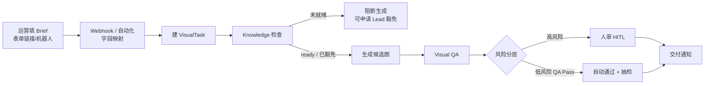

# 飞书里怎么提需（一页纸）

> 给运营 / 视觉 Lead 看 · EVAW 电商视觉 Agent 工作流  
> 白话版：你填一张 brief，系统帮你跑完出图与质检；该人审的节点才会叫你。

---

## 运营具体在哪填？（先看这里）

| 阶段 | 运营在哪填 | 说明 |
|------|------------|------|
| **正式入口（推荐）** | **飞书多维表格的「表单视图」分享链接** | 打开链接 → 填字段 → 提交。一行记录 = 一单提需。表建好后由 Lead/研发把链接发到运营群置顶。 |
| **备选入口** | **飞书群 @提需机器人** 按字段问答 / 交互卡片 | 适合手机随手提；字段与表单同一套契约。 |
| **当前可跑（工程侧）** | 本地 **webhook stub** 收表单回调，或 **`feishu-intake-from-json` / `feishu-intake` CLI** | 公网回调未挂好时，用 JSON/CLI 建任务；**运营日常不应依赖 CLI**。 |

**一句话给运营：** 以后你只打开群里置顶的 **「EVAW 提需表单」链接** 填表；填完群里会有建单通知。现在若还没有链接，找 Lead 要表单链接（或等 `feishu-bitable-setup` 建好多维表并「生成表单」）。

字段契约机器可读版：[`feishu_intake_field_map.json`](feishu_intake_field_map.json)。

---

## 先说清楚：现在 vs 正式版

| | **当前可落地** | **正式版（同字段）** |
|---|---|---|
| 怎么提需 | ① 多维表格表单视图（推荐）② 机器人引导 ③ webhook stub / CLI 收字段建任务 | 运营只走 ① 或 ②；回调自动建任务 |
| 通知 / 审批 | 有 `FEISHU_*` 凭证可发群；演示默认 `--feishu-mock` 不打扰 | 飞书内状态通知 + 人审跳转 |

---

## 整条链路长什么样



**高风险（必须人审）：** 新品 · 标了结构敏感 · QA 结果为 PassWithRisk · 或走了 Knowledge 豁免。  
**低风险：** 其余 QA Pass → 可自动 Approved，并按比例抽样审计。

---

## 提需要填哪些字段

建任务前请尽量一次填齐（缺关键字段会卡在策略 / 知识检查）：

| 字段 | 说明 | 举例 |
|------|------|------|
| **品牌** | brand_id | brand_xiu |
| **SKU** | 商品编码 | SKU-BED-001 |
| **平台** | tmall / jd / amazon / dtc | tmall |
| **图型** | hero 主图 / sku / pdp_module 详情模块 | hero |
| **卖点** | 2–5 条短句，按主次写 | 稳固承重；快速折叠 |
| **尺寸** | 平台规格，如 800x800 | 800x800 |
| **Deadline** | 期望交付日 | 2026-10-17 |
| **是否新品** | 是 → **强制人审** | 否 |

可选：风险标记（如 `structure_sensitive` 结构敏感）——勾上也会走人审。

---

## 方案 A：多维表格 + 表单视图（推荐给运营）

1. **建表（研发/Lead 一次）：**
   ```bash
   python3 -m evaw.cli feishu-bitable-setup --name "EVAW 提需"
   ```
   - 有飞书凭证且应用开通了多维表格权限 → 尝试 API 创建 Base + 列（字段映射见上表）。
   - 若 API 因权限失败 → 仍写出 [`feishu_intake_field_map.json`](feishu_intake_field_map.json) 与 [`feishu_bitable_setup_report.json`](feishu_bitable_setup_report.json)；请手工新建多维表并按报告里的 `fields[]` 建列。
2. **在飞书 UI：** 打开该多维表格 → **生成表单 / 新建表单视图** → 打开「分享」得到链接。
3. **发给运营：** 把表单链接置顶到运营群。**运营只在这个链接填。**
4. **进系统：**
   - 理想：飞书自动化 / 事件订阅 `record.created` → `POST /feishu/event`（见下节 webhook）。
   - 过渡：导出一行或保存回调 JSON → `feishu-intake-from-json`。

---

## 方案 B：机器人引导填字段（备选）

群内 @机器人，按顺序问：品牌 → SKU → 平台 → 图型 → 卖点 → 尺寸 → Deadline → 是否新品 → 风险标记。  
收齐后同一套 `payload_to_brief` → 建任务。交互卡片字段名须落在字段契约的 aliases 内。

---

## Webhook stub / CLI（工程接入）

本地 HTTP stub（可反代到公网做事件订阅）：

```bash
# 默认 mock，不发飞书 IM
python3 -m evaw.cli feishu-intake-webhook --port 8787
# POST http://127.0.0.1:8787/feishu/intake
# GET  http://127.0.0.1:8787/field-map
```

用样例 JSON 建一单（不发消息）：

```bash
python3 -m evaw.cli feishu-intake-from-json \
  --file docs/samples/feishu_intake_webhook_example.json
```

样例：

- [`samples/feishu_intake_webhook_example.json`](samples/feishu_intake_webhook_example.json) — 表单风格 fields
- [`samples/feishu_intake_bitable_record_example.json`](samples/feishu_intake_bitable_record_example.json) — 多维表记录事件风格

仍可用旧 CLI 模拟填表：

```bash
python3 -m evaw.cli feishu-intake \
  --brand brand_xiu --sku SKU-BED-001 \
  --platform tmall --asset-type hero \
  --selling-points "稳固承重,快速折叠" \
  --feishu-mock
```

| 入口 | 谁用 | 建任务 |
|------|------|--------|
| 多维表单链接 | **运营** | 提交 → webhook/自动化 → `ingest_payload` |
| 机器人问答 | 运营（手机） | 同左 |
| `feishu-intake-from-json` / webhook stub | 研发联调 | 同字段契约 |
| `feishu-intake` CLI | 演示 / 无飞书时 | 同字段契约 |

---

## 你（Cici / 视觉 Lead）在哪些节点出手

日常运营填 brief 即可；**你不用盯每一单**，只在这些闸门出现：

1. **Knowledge 豁免** — 知识包未就绪但业务要冲时：你批豁免工单 + 原因码；豁免后的任务 **一律强制人审**。  
2. **高风险人审** — 新品 / 结构敏感 / QA「带风险通过」：你在控制台（或飞书跳转）看候选图，批过或打回。  
3. **抽检打回** — 低风险自动放行被抽中审计时：若问题属实，你打回并写 reason_code，任务回流。  
4. **流程与标准** — 字段定义、HITL 分层、QA 维度由你定版；运营按表填，系统按闸门执行。  
5. **提需入口维护** — 确认表单链接有效、字段与 [`feishu_intake_field_map.json`](feishu_intake_field_map.json) 一致。

运营侧日常只做两件事：**在表单链接填齐 brief**，以及在飞书/通知里跟到 **交付通知**。

---

## 环境变量（提需相关）

| 变量 | 作用 |
|------|------|
| `FEISHU_APP_ID` / `FEISHU_APP_SECRET` | 真连 Open API（建多维表 / 发通知） |
| `FEISHU_CHAT_ID` | 群通知；未设则不发 IM |
| `FEISHU_BITABLE_FOLDER_TOKEN` | 可选，建 Base 到指定云文档文件夹 |
| `FEISHU_VERIFICATION_TOKEN` | 可选，事件订阅校验 |
| `EVAW_FEISHU_FORCE_MOCK=1` | 强制 mock |

`feishu-bitable-setup` **不会发群消息**。联调 webhook 默认 `--feishu-mock`；只有显式 `--live-notify` 才发 IM。

---

*文档对应仓库 EVAW · 与 PRD v0.2.1 / 架构方案 HITL、Knowledge 策略一致。*

---

**下一步：人审怎么在飞书拍板** → [`飞书人审聊天说明.md`](飞书人审聊天说明.md)
