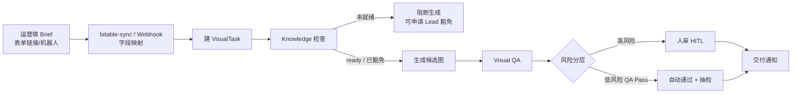

# 飞书里怎么提需（一页纸）

> 给运营 / 视觉 Lead 看 · EVAW 电商视觉 Agent 工作流  
> 白话版：你填一张 brief，系统帮你跑完出图与质检；该人审的节点才会叫你。

---

## 运营具体在哪填？（先看这里）

| 阶段 | 运营在哪填 | 说明 |
|------|------------|------|
| **正式入口（推荐）** | **飞书多维表格的「表单视图」分享链接** | 打开链接 → 填字段 → 提交。一行记录 = 一单提需。表建好后由 Lead/研发把链接发到运营群置顶。 |
| **备选入口** | **飞书群 @提需机器人** 按字段问答 / 交互卡片 | 适合手机随手提；字段与表单同一套契约。 |
| **当前可跑（工程侧）** | **`feishu-bitable-sync`** 轮询多维表新行建任务；也可 webhook stub / `feishu-intake-from-json` | 无公网回调时用同步 CLI（可 `--poll`）；**运营日常只填表单，不跑 CLI**。 |

**一句话给运营：** 以后你只打开群里置顶的 **「EVAW 提需表单」链接** 填表；填完群里会有建单通知。现在若还没有链接，找 Lead 要表单链接（或等 `feishu-bitable-setup` 建好多维表并「生成表单」）。

字段契约机器可读版：[`feishu_intake_field_map.json`](feishu_intake_field_map.json)。

---

## 先说清楚：现在 vs 正式版

| | **当前可落地** | **正式版（同字段）** |
|---|---|---|
| 怎么提需 | ① 多维表格表单视图（推荐）② 机器人引导 ③ webhook stub / CLI 收字段建任务 | 运营只走 ① 或 ②；回调自动建任务 |
| 通知 / 审批 | 有 `FEISHU_*` 凭证可发群；演示默认 `--feishu-mock` 不打扰 | 飞书内状态通知 + 人审跳转 |

---

## 整条链路长什么样



**高风险（必须人审）：** 新品 · 标了结构敏感 · QA 结果为 PassWithRisk · 或走了 Knowledge 豁免。  
**低风险：** 其余 QA Pass → 可自动 Approved，并按比例抽样审计。

---

## 提需要填哪些字段（v1.1 · 支持主图包 / 多规格 / 多张详情）

建任务前请尽量一次填齐（缺关键字段会卡在策略 / 知识检查）。  
机器可读契约：[`feishu_intake_field_map.json`](feishu_intake_field_map.json)（version **1.1**）。

### 必填 / 常用

| 字段 | 说明 | 举例 |
|------|------|------|
| **品牌** | brand_id | brand_xiu |
| **主SKU** | 主商品编码；多规格时仍填主款 | SKU-BED-001 |
| **平台** | tmall / jd / amazon / dtc | tmall |
| **图型** | 见下表六选一 | hero_pack |
| **卖点** | 2–5 条短句，按主次写 | 稳固承重；快速折叠 |
| **尺寸** | 单张画布尺寸（包内每张同尺寸） | 800x800 |
| **Deadline** | 期望交付日（可空＝提交日+7天） | 2026-10-17 |
| **是否新品** | 是 → **强制人审** | 否 |

可选：风险标记（如 `structure_sensitive` 结构敏感）——勾上也会走人审。

### 图型怎么选

| 图型 key（入库） | 表单可显示成 | 何时用 | 还要填 |
|------------------|--------------|--------|--------|
| `hero` | 主图 | 只要 **1 张** 主图 | — |
| `hero_pack` | **主图包** | 一次出多张主图位（常见 5 张） | **出图张数** + **主图包槽位** |
| `sku` | SKU图 | **单规格** 白底/角度图 | — |
| `sku_multi` | **多规格SKU** | 多色/多规格各出一张 | **规格列表**（张数可自动按条数） |
| `pdp_module` | 详情模块 | 只要 **1 个** 详情模块 | — |
| `pdp_set` | **多张详情** | 详情长图拆成多个模块 | **出图张数** + **详情模块清单** |

### 套装/多规格专用字段（按图型选填）

| 字段 | 说明 | 举例 |
|------|------|------|
| **出图张数** | 这单要出几张；主图包常见 5 | 5 |
| **主图包槽位** | 主图包时按位写清每张内容 | 1白底主图;2卖点承重;3卖点折叠;4场景客房;5尺码表 |
| **规格列表** | 多规格SKU 的色号/子SKU，逗号分隔 | 米白,烟灰,藏青 |
| **详情模块清单** | 多张详情时按从上到下模块写 | 材质细节,承重测试,折叠演示,场景氛围,规格参数 |

**填表口诀：**  
- 主图包 → 图型选主图包 + 张数 + 槽位说明  
- 多规格 → 图型选多规格SKU + 规格列表（可不填张数）  
- 多张详情 → 图型选多张详情 + 张数 + 模块清单  

---

## 方案 A：多维表格 + 表单视图（推荐给运营）

1. **建表（研发/Lead 一次）：**
   ```bash
   python3 -m evaw.cli feishu-bitable-setup --name "EVAW 提需"
   ```
   - 有飞书凭证且应用开通了多维表格权限 → 尝试 API 创建 Base + 列（字段映射见上表）。
   - 若 API 因权限失败 → 仍写出 [`feishu_intake_field_map.json`](feishu_intake_field_map.json) 与 [`feishu_bitable_setup_report.json`](feishu_bitable_setup_report.json)；请手工新建多维表并按报告里的 `fields[]` 建列。
2. **在飞书 UI：** 打开该多维表格 → **生成表单 / 新建表单视图** → 打开「分享」得到链接。
3. **发给运营：** 把表单链接置顶到运营群。**运营只在这个链接填。**
4. **进系统：**
   - **推荐（无公网也可）：** `python3 -m evaw.cli feishu-bitable-sync`（或 `--poll --interval 60`）用飞书凭证拉新行建任务。
   - 理想：飞书自动化 / 事件订阅 `record.created` → `POST /feishu/event`（见下节 webhook）。
   - 过渡：导出一行或保存回调 JSON → `feishu-intake-from-json`。

---

## 方案 B：机器人引导填字段（备选）

群内 @机器人，按顺序问：品牌 → 主SKU → 平台 → 图型 →（若主图包/多规格/多张详情再问张数与槽位/规格/模块）→ 卖点 → 尺寸 → Deadline → 是否新品 → 风险标记。  
收齐后同一套 `payload_to_brief` → 建任务。交互卡片字段名须落在字段契约的 aliases 内。

---

## 多维表同步进 EVAW（推荐 · 无公网）

运营在表单提交后，多维表多一行。工程侧用飞书 Open API **拉新记录 → 建 VisualTask**（按 `record_id` 去重）：

```bash
# 一次性同步未处理的新行（默认 mock，不发群）
python3 -m evaw.cli feishu-bitable-sync

# 只看会建哪些单（不写任务）
python3 -m evaw.cli feishu-bitable-sync --dry-run

# 持续轮询（例如每 60 秒）
python3 -m evaw.cli feishu-bitable-sync --poll --interval 60

# 建单后发飞书群通知（需 FEISHU_CHAT_ID）
python3 -m evaw.cli feishu-bitable-sync --live-notify
```

| 环境变量 | 默认（当前个人提需表） |
|----------|------------------------|
| `FEISHU_BITABLE_APP_TOKEN` | `B8kubs46saK9ZnsII2IcLNbXntg` |
| `FEISHU_BITABLE_TABLE_ID` | `tblessb0FYqQUYg4` |
| `FEISHU_INTAKE_FORM_URL` | 见下方「运营填表入口」 |

状态文件：`artifacts/feishu_bitable_sync_state.json`（已同步的 `record_id`）。  
样例 env：[`feishu_bitable_intake_env.example.json`](feishu_bitable_intake_env.example.json)。

**运营填表后会发生什么**

1. 打开表单链接 → 填品牌/主SKU/平台/图型/… → 提交。  
2. 多维表格新增一行（`record_id`）。  
3. 有人跑 `feishu-bitable-sync`（或 `--poll` 守护）时：映射字段 → 创建 EVAW `VisualTask`（状态多为 `ReadyForStrategy`）→ 本地 intake 快照。  
4. 若加了 `--live-notify`：飞书群收到「填表提需已建任务」通知。  
5. 同一行不会重复建单（除非 `--include-synced`）。  
6. 之后仍按原流水线跑策略 / 出图 / QA / 人审（提需这一步只负责**建任务**）。

---

## Webhook stub / CLI（工程接入）

本地 HTTP stub（可反代到公网做事件订阅）：

```bash
# 默认 mock，不发飞书 IM
python3 -m evaw.cli feishu-intake-webhook --port 8787
# POST http://127.0.0.1:8787/feishu/intake
# GET  http://127.0.0.1:8787/field-map
```

用样例 JSON 建一单（不发消息）：

```bash
python3 -m evaw.cli feishu-intake-from-json \
  --file docs/samples/feishu_intake_webhook_example.json
```

样例：

- [`samples/feishu_intake_webhook_example.json`](samples/feishu_intake_webhook_example.json) — 表单风格 fields
- [`samples/feishu_intake_bitable_record_example.json`](samples/feishu_intake_bitable_record_example.json) — 多维表记录事件风格

仍可用旧 CLI 模拟填表：

```bash
python3 -m evaw.cli feishu-intake \
  --brand brand_xiu --sku SKU-BED-001 \
  --platform tmall --asset-type hero \
  --selling-points "稳固承重,快速折叠" \
  --feishu-mock
```

| 入口 | 谁用 | 建任务 |
|------|------|--------|
| 多维表单链接 | **运营** | 提交 → 多维表新行 |
| `feishu-bitable-sync`（可 `--poll`） | **研发/值班** | 拉新行 → `ingest_payload` → VisualTask |
| 机器人问答 | 运营（手机） | 同字段契约 |
| `feishu-intake-from-json` / webhook stub | 研发联调 | 同字段契约 |
| `feishu-intake` CLI | 演示 / 无飞书时 | 同字段契约 |

---

## 你（Cici / 视觉 Lead）在哪些节点出手

日常运营填 brief 即可；**你不用盯每一单**，只在这些闸门出现：

1. **Knowledge 豁免** — 知识包未就绪但业务要冲时：你批豁免工单 + 原因码；豁免后的任务 **一律强制人审**。 正式/演示请先在 [`knowledge/`](../knowledge/README.md) 为真实 SKU（如 `sku-bed-01`）补 VIS/结构/平台规范，避免再走豁免；`SKU-BED-MISSING` 仍保留为阻断演示。  
2. **高风险人审** — 新品 / 结构敏感 / QA「带风险通过」：你在控制台（或飞书跳转）看候选图，批过或打回。  
3. **抽检打回** — 低风险自动放行被抽中审计时：若问题属实，你打回并写 reason_code，任务回流。  
4. **流程与标准** — 字段定义、HITL 分层、QA 维度由你定版；运营按表填，系统按闸门执行。  
5. **提需入口维护** — 确认表单链接有效、字段与 [`feishu_intake_field_map.json`](feishu_intake_field_map.json) 一致。

运营侧日常只做两件事：**在表单链接填齐 brief**，以及在飞书/通知里跟到 **交付通知**。

---

## 环境变量（提需相关）

| 变量 | 作用 |
|------|------|
| `FEISHU_APP_ID` / `FEISHU_APP_SECRET` | 真连 Open API（建多维表 / 发通知） |
| `FEISHU_CHAT_ID` | 群通知；未设则不发 IM |
| `FEISHU_BITABLE_FOLDER_TOKEN` | 可选，建 Base 到指定云文档文件夹 |
| `FEISHU_BITABLE_APP_TOKEN` / `FEISHU_BITABLE_TABLE_ID` | 同步目标多维表（有默认：个人提需表） |
| `FEISHU_INTAKE_FORM_URL` | 运营表单链接（文档/状态里展示） |
| `FEISHU_VERIFICATION_TOKEN` | 可选，事件订阅校验 |
| `EVAW_FEISHU_FORCE_MOCK=1` | 强制 mock |

`feishu-bitable-setup` **不会发群消息**。联调 webhook 默认 `--feishu-mock`；只有显式 `--live-notify` 才发 IM。

---

*文档对应仓库 EVAW · 字段契约 v1.1（主图包/多规格SKU/多张详情）· 与 PRD v0.2.1 / 架构方案 HITL、Knowledge 策略一致。*

---

**下一步：人审怎么在飞书拍板** → [`飞书人审聊天说明.md`](飞书人审聊天说明.md)


## 运营填表入口（已开通 · 个人提需表）

- **表单链接（请置顶群）：** https://scnjh6x3pkck.feishu.cn/share/base/form/shrcn3nkmUrA2XYufTexOC3uO5b
- **多维表本体：** https://scnjh6x3pkck.feishu.cn/base/B8kubs46saK9ZnsII2IcLNbXntg
- 运营打开链接填写：品牌 / 主SKU / 平台 / 图型 / 出图张数 / 主图包槽位 / 规格列表 / 详情模块清单 / 卖点 / 尺寸 / Deadline / 是否新品 / 风险标记
- 填完后工程侧跑 `feishu-bitable-sync`（或 `--poll`）就会进 EVAW；见上文「多维表同步进 EVAW」

---

## Cici：个人提需表怎么改字段（白话步骤）

你已经有一张 EVAW 提需多维表 + 表单链接。不用重建整张表，按下面改就行（约 10 分钟）。

### 1）打开数据表（不是表单分享页）

1. 打开多维表格本体：https://scnjh6x3pkck.feishu.cn/base/B8kubs46saK9ZnsII2IcLNbXntg  
2. 进到提需那张数据表（有「品牌 / SKU / 平台…」那些列的表格视图）。

### 2）改「图型」选项（最重要）

1. 点列头 **「图型」** → **编辑字段**（或字段配置）。  
2. 在选项里保留原来的 `hero` / `sku` / `pdp_module`（旧单还能认）。  
3. **新增三个选项**（名称建议直接用英文 key，和契约一致；想给运营看中文也可以，系统都能映射）：  
   - `hero_pack`（或显示名写「主图包」）  
   - `sku_multi`（或「多规格SKU」）  
   - `pdp_set`（或「多张详情」）  
4. 保存。

### 3）新增四列（套装信息）

在表里 **添加字段/列**，按这个建（类型都选「文本」，简单好填）：

| 列名（必须一致） | 类型 | 给运营的填写提示（可写在字段描述里） |
|------------------|------|--------------------------------------|
| **出图张数** | 文本 | 主图包/多规格/多张详情时填数字，如 5 |
| **主图包槽位** | 文本 | 仅主图包：1白底主图;2卖点… 按位写 |
| **规格列表** | 文本 | 仅多规格：米白,烟灰,藏青 |
| **详情模块清单** | 文本 | 仅多张详情：材质细节,承重测试,… |

可选：把原来的列名 **「SKU」改成「主SKU」**（改了也没关系，系统认「SKU」「主SKU」两种）。

### 4）让表单里也能填到新字段

1. 切到这张表的 **表单视图**（或「生成表单」那个视图）。  
2. 检查表单里是否出现刚加的四列；没有就在表单编辑里 **勾选显示** 这四个字段。  
3. 建议顺序：品牌 → 主SKU → 平台 → **图型** → **出图张数** → **主图包槽位** → **规格列表** → **详情模块清单** → 卖点 → 尺寸 → Deadline → 是否新品 → 风险标记。  
4. 可在表单说明里贴三句口诀（见上「填表口诀」）。  
5. 保存后，用原来的分享链接试填一单「主图包」验证；**分享链接一般不用换**。

### 5）改完怎么验收

- 表格视图能看到新列；表单提交后新行里张数/槽位/规格/模块有值。  
- 对照 [`feishu_intake_field_map.json`](feishu_intake_field_map.json) 的 `label_zh`：列名一致即可（别写成「张数」「模块」等简称，避免对不上）。  
- 工程侧用 `feishu-intake-from-json` 喂带新字段的样例，确认能建任务（主图包会按 hero 管线跑，多规格按 sku，多张详情按 pdp_module；套装明细留在 brief.raw.pack）。
