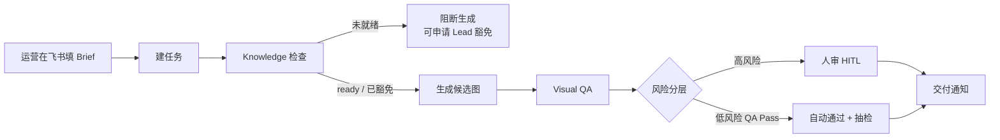

# 飞书里怎么提需（一页纸）

> 给运营 / 视觉 Lead 看 · EVAW 电商视觉 Agent 工作流  
> 白话版：你填一张 brief，系统帮你跑完出图与质检；该人审的节点才会叫你。

---

## 先说清楚：现在 vs 正式版

| | **当前 MVP** | **正式版（规划）** |
|---|---|---|
| 怎么提需 | 用 **`feishu-intake` CLI 模拟填表**（字段 → VisualTask → 通知） | 在 **飞书问卷** 或 **机器人卡片** 里填完即建任务 |
| 通知 / 审批 | 可走飞书 mock 或真连 Open API（有凭证时） | 飞书内状态通知 + 审批跳转控制台 |

**一句话：** 字段契约按飞书入口设计；MVP 用 `feishu-intake` 代替点表单，正式版换成飞书问卷/机器人。

---

## 整条链路长什么样



**高风险（必须人审）：** 新品 · 标了结构敏感 · QA 结果为 PassWithRisk · 或走了 Knowledge 豁免。  
**低风险：** 其余 QA Pass → 可自动 Approved，并按比例抽样审计。

---

## 提需要填哪些字段

建任务前请尽量一次填齐（缺关键字段会卡在策略 / 知识检查）：

| 字段 | 说明 | 举例 |
|------|------|------|
| **品牌** | brand_id | brand_xiu |
| **SKU** | 商品编码 | SKU-BED-001 |
| **平台** | tmall / jd / amazon / dtc | tmall |
| **图型** | hero 主图 / sku / pdp_module 详情模块 | hero |
| **卖点** | 2–5 条短句，按主次写 | 稳固承重；快速折叠 |
| **尺寸** | 平台规格，如 800x800 | 800x800 |
| **Deadline** | 期望交付日 | 2026-10-17 |
| **是否新品** | 是 → **强制人审** | 否 |

可选：风险标记（如 `structure_sensitive` 结构敏感）——勾上也会走人审。

---

## 你（Cici / 视觉 Lead）在哪些节点出手

日常运营填 brief 即可；**你不用盯每一单**，只在这些闸门出现：

1. **Knowledge 豁免** — 知识包未就绪但业务要冲时：你批豁免工单 + 原因码；豁免后的任务 **一律强制人审**。  
2. **高风险人审** — 新品 / 结构敏感 / QA「带风险通过」：你在控制台（或飞书跳转）看候选图，批过或打回。  
3. **抽检打回** — 低风险自动放行被抽中审计时：若问题属实，你打回并写 reason_code，任务回流。  
4. **流程与标准** — 字段定义、HITL 分层、QA 维度由你定版；运营按表填，系统按闸门执行。

运营侧日常只做两件事：**填齐 brief**，以及在飞书/通知里跟到 **交付通知**。

---

## MVP 怎么演示提需（CLI 模拟表单）

当前 **没有** 真飞书问卷入口；用 CLI 把同一套卡片/表单字段喂进系统：

```bash
cd ecommerce-visual-agentic-workflow

# 填表提需最小版：字段 → 建 VisualTask → 飞书通知（有 FEISHU 凭证时发群）
python3 -m evaw.cli feishu-intake \
  --brand brand_xiu \
  --sku SKU-BED-001 \
  --platform tmall \
  --asset-type hero \
  --selling-points "稳固承重,快速折叠,客房场景" \
  --size 800x800 \
  --deadline 2026-10-17T00:00:00+08:00

# 新品（后续强制人审）
python3 -m evaw.cli feishu-intake \
  --brand brand_xiu --sku SKU-BED-NEW --new-product \
  --selling-points "结构真实,侧板完整"

# 强制本地 mock（不发真 IM）
python3 -m evaw.cli feishu-intake --brand brand_xiu --sku SKU-BED-001 --feishu-mock

# 完整演示链路（提需后继续跑策略/生成/人审）
python3 -m evaw.cli feishu-demo
```

| | **MVP（现在）** | **正式版（规划）** |
|---|---|---|
| 入口 | `feishu-intake` CLI 模拟表单字段 | **飞书问卷 / 机器人卡片** 填完即建任务 |
| 建任务 | `create_task_from_brief` → `VisualTask` | 同左 |
| 通知 | 有 `FEISHU_APP_ID`+`SECRET`（+`CHAT_ID`）→ 群通知；否则 mock 落盘 | 飞书内状态通知 |

**一句话：** 字段契约已定；演示用 CLI 代替点表单，正式上线换成飞书问卷/机器人，后面节点不变。

---

*文档对应仓库 EVAW · 与 PRD v0.2.1 / 架构方案 HITL、Knowledge 策略一致。*

---

**下一步：人审怎么在飞书拍板** → [`飞书人审聊天说明.md`](飞书人审聊天说明.md)
